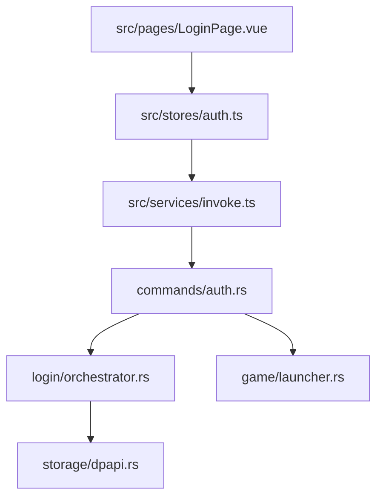

# pungin/Beanfun

> Lanceur tiers non officiel pour les jeux de Gamania (Beanfun), sous Windows.

## Le problème
Le client officiel de Beanfun est contraignant ; ce lanceur gère la connexion et le démarrage des jeux autrement.

## Ce que ça fait vraiment
Application Tauri v2 : une interface Vue appelle des commandes Rust via invoke.ts. Un orchestrateur gère la connexion, le stockage chiffré DPAPI garde les comptes, puis le lanceur démarre le jeu avec Locale Remulator (LRProc.exe et des DLL de hook générés à côté).

## Comment c'est branché


## Essayer
```bash
npm install
npm run tauri dev
```
Sinon, binaires dans la page des releases.

## Coût et pièges
Gratuit. Windows 10+ et WebView2. Aucune licence n'est déclarée. Rust et Node 22 pour compiler. Le README, en chinois, avertit qu'il n'est pas officiel et que se connecter par un tiers est un risque : tu y saisis tes identifiants de jeu.

## Ce que ce n'est pas
Pas un client officiel ni un outil pour autre chose que ces jeux. Des DLL de hook sont injectées dans le jeu.

## Alternatives
MapleLink, lanceur frère pour le seul jeu MapleStory, cité dans le README.

## Pour toi
Ignorer : lanceur de jeu, sans lien avec un travail data, IA ou MLOps, et sans licence.

