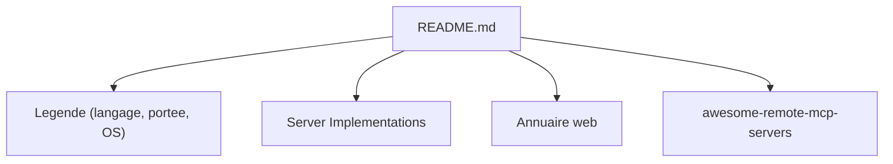

# punkpeye/awesome-mcp-servers

> Community-maintained list of MCP servers, categorized for connecting an AI agent to various tools.

## The problem
There are thousands of MCP servers available; finding one that meets your specific needs (database, browser, cloud) can be a lengthy and uncertain process.

## What it actually does
A README lists servers by category (aggregators, databases, browser, cloud, code, search, security, finance...), with icons for language (Python, TypeScript, Go, Rust), scope (cloud, local), and OS. Each entry is a link and a brief description. A web directory is synchronized with the repository. The README provided is truncated after the "aggregators" section: the other categories are not read.

## How it is wired

## Trying it
No general command: navigate to the README. Example for a specific tool: `uv tool install terse-mcp`.

## Cost and gotchas
The list is free; many of the servers listed are paid APIs (payments x402, API keys). Entries have not been verified by the authors, including security aspects. The README includes an advertisement at the top.

## What it is not
This is not a guaranteed or audited registry. It only covers servers that you install yourself, not servers that are hosted.

## Alternatives
awesome-remote-mcp-servers: for servers that are accessed via URL (as mentioned in the README).

## For you
This should be used as a starting point for identifying MCP data/AI servers, while verifying each project before granting it access to your data.
