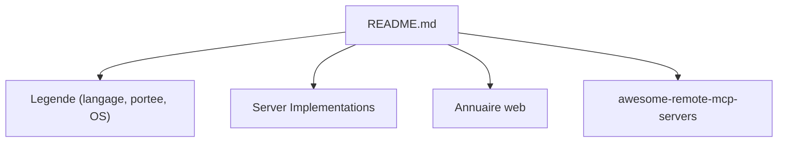

# punkpeye/awesome-mcp-servers

> Liste communautaire de serveurs MCP classés par catégorie, pour brancher un agent IA à des outils.

## Le problème
Des milliers de serveurs MCP existent ; trouver celui qui couvre ton besoin (base de données, navigateur, cloud) est long et incertain.

## Ce que ça fait vraiment
Un README énumère les serveurs par catégories (agrégateurs, bases de données, navigateur, cloud, code, recherche, sécurité, finance...), avec des icônes pour langage (Python, TypeScript, Go, Rust), portée (cloud, local) et OS. Chaque entrée est un lien et une ligne de description. Un annuaire web est synchronisé avec le dépôt. Le README fourni est tronqué après les agrégateurs : les autres catégories ne sont pas lues.

## Comment c'est branché

## Essayer
Aucune commande générale : parcourir le README. Exemple pour un agrégateur cité : `uv tool install terse-mcp`.

## Coût et pièges
La liste est gratuite ; beaucoup de serveurs listés sont des API payantes (paiements x402, clés API). Entrées non vérifiées par le dépôt, y compris sur la sécurité. Le README affiche une publicité en tête.

## Ce que ce n'est pas
Pas un registre garanti ni audité. Ne couvre que les serveurs à installer soi-même, pas les serveurs hébergés.

## Alternatives
awesome-remote-mcp-servers : pour les serveurs hébergés auxquels on se connecte par URL (cité dans le README).

## Pour toi
À adopter comme point de départ pour repérer des serveurs MCP data/IA, en vérifiant chaque projet avant de lui donner accès à tes données.

