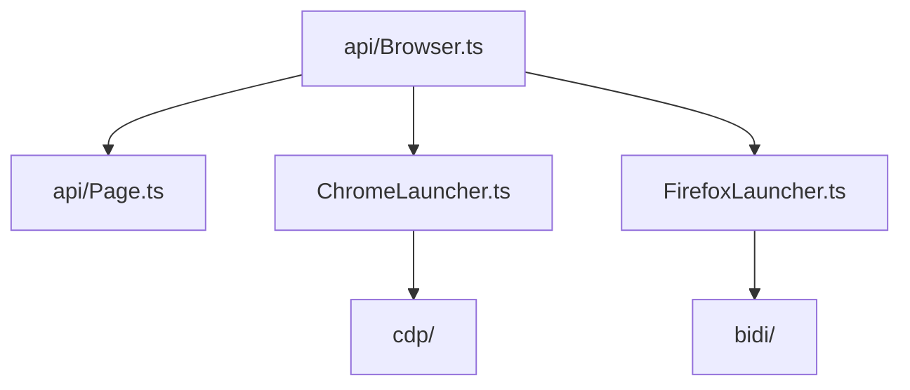

# puppeteer/puppeteer

> JavaScript library for controlling Chrome or Firefox via the DevTools Protocol or WebDriver BiDi, with headless mode enabled by default.

## The problem
Automating a web browser (capturing screenshots, creating PDFs, filling out forms, and web scraping) requires low-level control of the protocol.

## What it actually does
A high-level API (for Browser, Page, Frame, Input, and network) relies on two protocols: CDP for Chrome and WebDriver BiDi for Firefox. It manages launching, contexts, network interception, coverage, screenshots, and device emulation. The README mentions `chrome-devtools-mcp`, a MCP server based on Puppeteer, and experimental support for WebMCP.

## How it is wired


## Trying it
```bash
npm i puppeteer
npm i puppeteer-core
npx puppeteer browsers install
```

## Cost and gotchas
Free. `puppeteer` downloads Chrome during installation; if the package manager blocks the installation script, you need to run `npx puppeteer browsers install` or allow the script to run.

## What it is not
It's not a testing framework; it doesn't include a test runner or integrated reports. Firefox support is provided through BiDi, not CDP.

## Alternatives
No alternative is specified in the README.

## For you
Suitable for scraping or capturing data within a data pipeline; if you also need cross-browser testing, consider Playwright, which is from the same family of tools.
