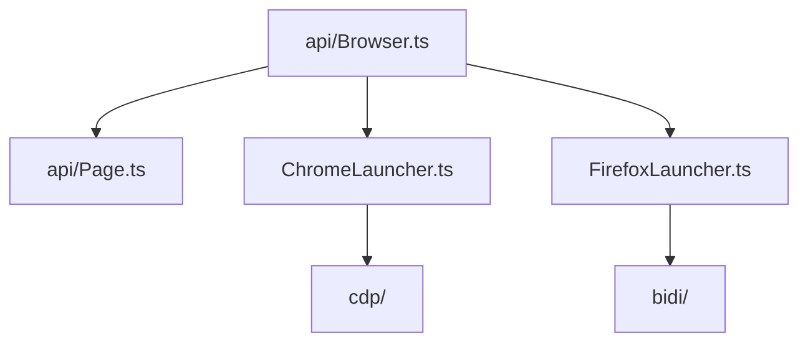

# puppeteer/puppeteer

> Bibliothèque JavaScript pour piloter Chrome ou Firefox via DevTools Protocol ou WebDriver BiDi, en mode headless par défaut.

## Le problème
Automatiser un navigateur (captures, PDF, formulaires, scraping) demande un pilotage bas niveau du protocole.

## Ce que ça fait vraiment
Une API haut niveau (Browser, Page, Frame, Input, réseau) s'appuie sur deux protocoles : CDP pour Chrome et WebDriver BiDi pour Firefox. Elle gère lancement, contextes, interception réseau, couverture, captures et émulation d'appareils. Le README mentionne `chrome-devtools-mcp`, un serveur MCP basé sur Puppeteer, et un support expérimental de WebMCP.

## Comment c'est branché


## Essayer
```bash
npm i puppeteer
npm i puppeteer-core
npx puppeteer browsers install
```

## Coût et pièges
Gratuit. `puppeteer` télécharge Chrome à l'installation ; si le gestionnaire de paquets bloque le script d'installation, il faut lancer `npx puppeteer browsers install` ou autoriser le script.

## Ce que ce n'est pas
Pas un framework de test : il n'a ni lanceur de tests ni rapports intégrés. Le support Firefox passe par BiDi, pas CDP.

## Alternatives
Aucune alternative nommée dans le README.

## Pour toi
À adopter pour du scraping ou des captures dans un pipeline de données ; si tu veux aussi des tests multi-navigateurs, regarde plutôt Playwright, du même domaine.

