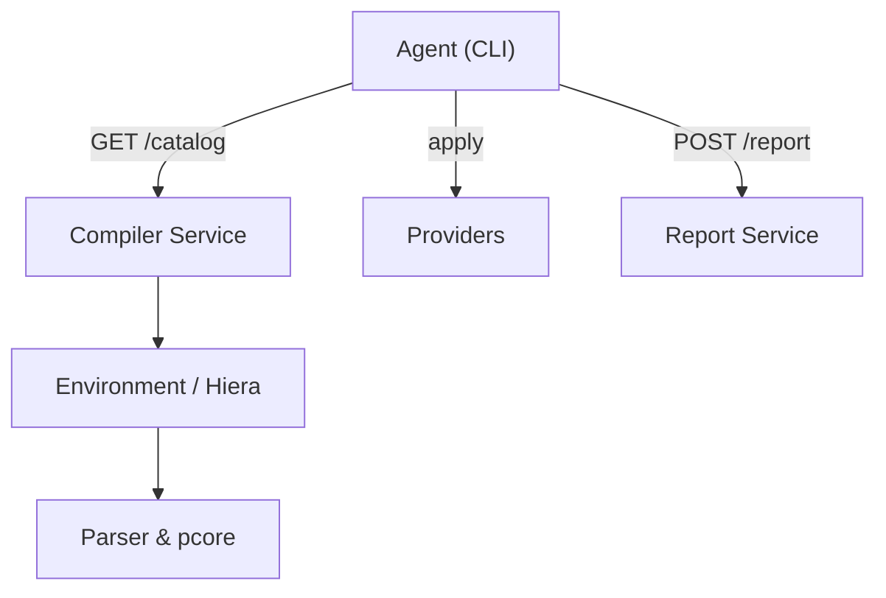

# puppetlabs/puppet

> Automated system administration engine for Linux, Unix and Windows from a central specification.

## The problem
Configuring dozens of servers by hand (users, packages, services) produces drift and errors.

## What it actually does
An agent fetches from a server a catalog compiled from manifests, then applies the resources (files, packages, services, users) via providers. It then sends a report. Based on the code: CLI (agent, apply, module, lookup), compiler, Indirector, file service, SSL, Hiera.

## How it is wired

## Trying it
No command documented in the README: it points to the installation guide and the "Quick Start to Developing on Puppet".

## Cost and gotchas
The code is free under Apache, but the README recommends Puppet Enterprise (paid, with console and support) as the best way to run Puppet. A dedicated server is needed for agent mode.

## What it is not
Not a turnkey solution: you have to learn its declarative language. The README pushes the Enterprise version.

## Alternatives
No alternative named in the README.

## For you
Ignore for modern MLOps: this kind of configuration management is generally replaced by containers and Kubernetes; useful only for an existing fleet.
