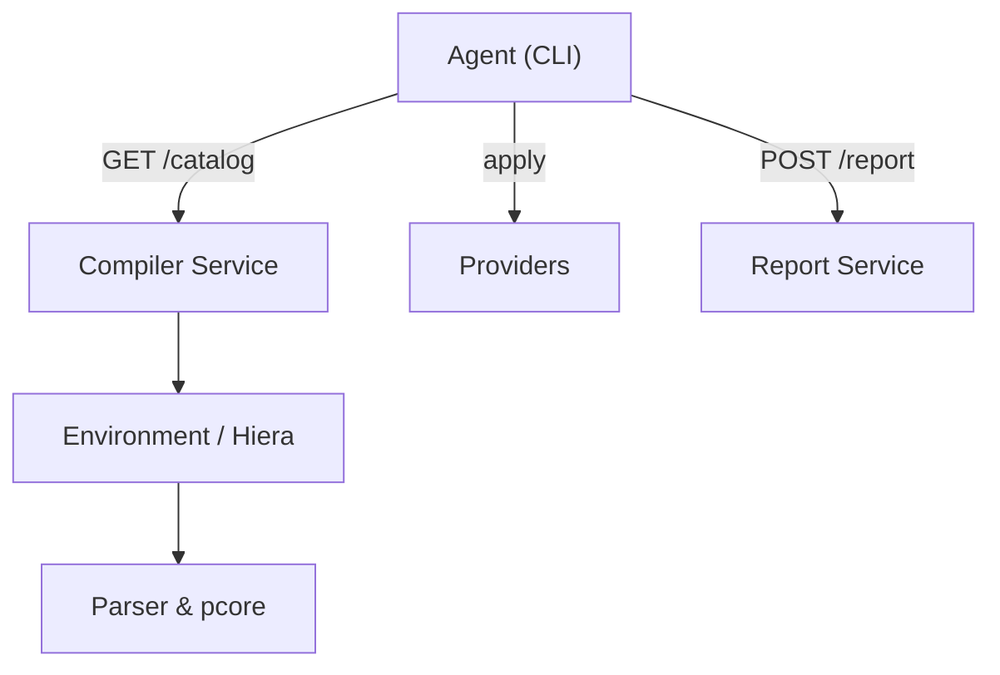

# puppetlabs/puppet

> Moteur d'administration automatisée de systèmes Linux, Unix et Windows à partir d'une spécification centrale.

## Le problème
Configurer des dizaines de serveurs à la main (utilisateurs, paquets, services) produit des écarts et des erreurs.

## Ce que ça fait vraiment
Un agent récupère auprès d'un serveur un catalogue compilé depuis des manifestes, puis applique les ressources (fichiers, paquets, services, utilisateurs) via des fournisseurs. Il envoie ensuite un rapport. D'après le code : CLI (agent, apply, module, lookup), compilateur, Indirector, service de fichiers, SSL, Hiera.

## Comment c'est branché

## Essayer
Aucune commande documentée dans le README : il renvoie au guide d'installation et au « Quick Start to Developing on Puppet ».

## Coût et pièges
Le code est gratuit sous Apache, mais le README recommande Puppet Enterprise (payant, avec console et support) comme meilleure façon d'exécuter Puppet. Un serveur dédié est nécessaire pour le mode agent.

## Ce que ce n'est pas
Pas une solution clé en main : il faut apprendre son langage déclaratif. Le README pousse la version Enterprise.

## Alternatives
Aucune alternative nommée dans le README.

## Pour toi
À ignorer pour du MLOps moderne : ce type de gestion de configuration est généralement remplacé par des conteneurs et du Kubernetes ; utile seulement pour un parc existant.

