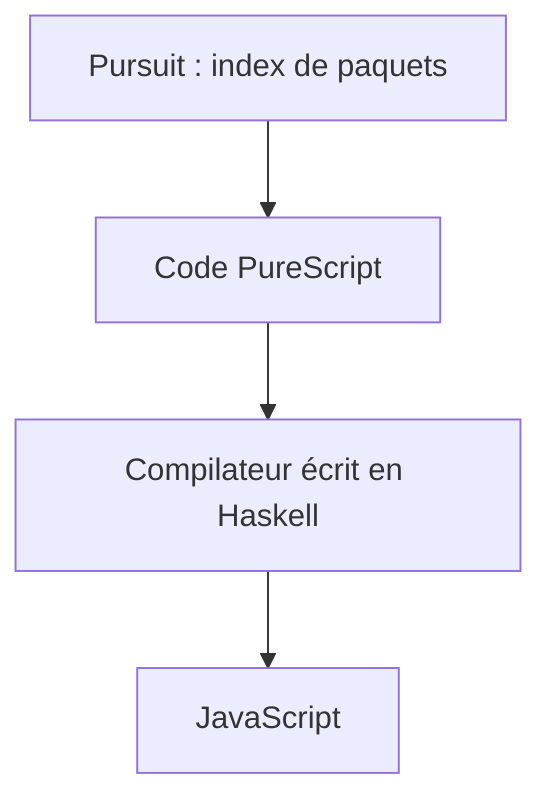

# purescript/purescript

> Strongly typed, Haskell-inspired language that compiles to JavaScript, for web developers.

## The problem
JavaScript offers no expressive types. PureScript brings Haskell-style strong typing while producing JavaScript.

## What it actually does
The README contains only links: home page, release notes, book, documentation, the Pursuit package index, help channels. It only says that it is a small, strongly typed language, written in Haskell, compiling to JavaScript. Installation, commands and architecture are not documented here.

## How it is wired
Simplified diagram based on the fiche, no diagram provided.

## Trying it
No command documented in this README: see the PureScript site and the book (links are present, no URL provided).

## Cost and gotchas
Free. The real cost is learning a language from the Haskell family. License not identified by GitHub.

## What it is not
It is not a data or AI tool. The listed help spaces are not covered by the project's code of conduct.

## Alternatives
No alternative named in the README.

## For you
Ignore: a language targeting JavaScript brings nothing to a data / AI / MLOps profile, and the README does not allow going further.
