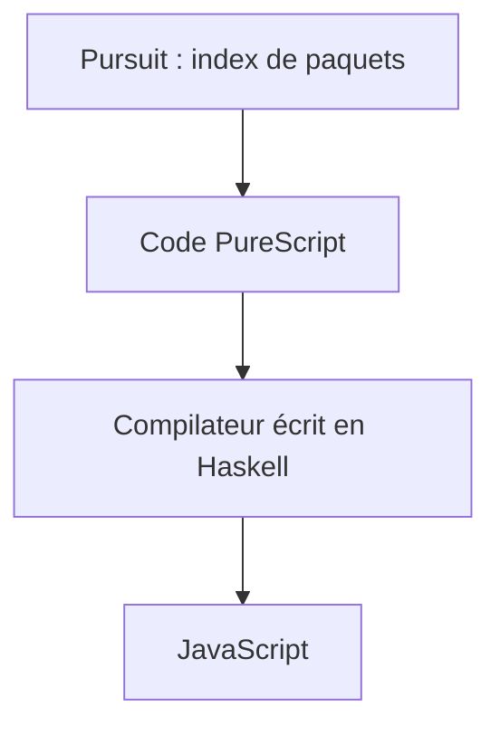

# purescript/purescript

> Langage fortement typé, inspiré de Haskell, qui compile vers JavaScript, pour développeurs web.

## Le problème
JavaScript n'offre pas de types expressifs. PureScript apporte un typage fort de style Haskell tout en produisant du JavaScript.

## Ce que ça fait vraiment
Le README ne contient que des liens : accueil, notes de version, livre, documentation, index de paquets Pursuit, canaux d'aide. Il dit seulement que c'est un petit langage fortement typé, écrit en Haskell, compilant vers JavaScript. Installation, commandes et architecture ne sont pas documentées ici.

## Comment c'est branché
Schéma simplifié d'après la fiche, sans diagramme fourni.

## Essayer
Aucune commande documentée dans ce README : voir le site PureScript et le livre (liens présents, sans URL fournie).

## Coût et pièges
Gratuit. Le coût réel est l'apprentissage d'un langage de la famille Haskell. Licence non identifiée par GitHub.

## Ce que ce n'est pas
Ce n'est pas un outil data ni IA. Les espaces d'entraide listés ne sont pas couverts par le code de conduite du projet.

## Alternatives
Aucune alternative nommée dans le README.

## Pour toi
À ignorer : un langage vers JavaScript n'apporte rien à un profil data / IA / MLOps, et le README ne permet pas d'aller plus loin.

