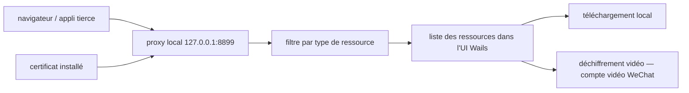

# putyy/res-downloader

> **One sentence.** Go + Wails desktop application that intercepts traffic through a local proxy to spot and download videos, audio, images and m3u8.

## The problem

Retrieving media displayed in a closed application (mini-program, WeChat video account, mobile app) normally requires setting up an interception proxy like Fiddler or Charles, installing a certificate, then reading the requests yourself. The README states this explicitly: same principle, but a barrier to use too high for a non-technical audience.

## What it actually does

The software starts a local proxy (address `127.0.0.1`, port `8899` according to the FAQ) and filters the traffic passing through it to extract resources. The announced types are video, audio, image, m3u8 and direct stream. The platforms cited are the WeChat video account, mini-programs, Douyin, Kuaishou, Xiaohongshu, Kugou Music and QQ Music. The interface lists the detected resources as you browse outside the software. An operation `视频解密（视频号）` (video decryption for the WeChat video account) is available on the list entries. The README also mentions an outbound proxy setting to reach resources on a restricted network.

## How it is wired



No code-derived diagram is available for this repo: the diagram above is reconstructed from the README alone, which names no source file.

## Trying it

No build or installation command is documented in the README: distribution goes through binaries on the GitHub Releases page (or a Lanzou mirror, password `9vs5`). The procedure described is:

```text
1. À l'installation, autoriser l'installation du certificat et l'accès réseau
2. Ouvrir le logiciel → en haut à gauche de l'accueil, cliquer « 启动代理 » (démarrer le proxy)
3. Choisir les types de ressources voulus (tous par défaut)
4. Ouvrir la page de la ressource à l'extérieur (compte vidéo, mini-programme, page web…)
5. Revenir sur l'accueil : la liste des ressources s'affiche
```

## Cost and gotchas

Free, no API key or account. The real cost is elsewhere: you must accept the installation of a root certificate and the hijacking of the machine's system proxy. The README warns that after closing the software the connection may be cut until you reset the system proxy by hand. Windows 7 users must stay on version `2.3.0`. Slow downloads or failing large files are sent to third-party tools (Neat Download Manager, Motrix), and live streams to OBS: these are therefore not covered cases. Finally, the README announces a slowed maintenance pace, the author having little time to devote to it.

## What it is not

It is not a library nor a CLI that you call from a script or a pipeline: it is a workstation graphical application, driven with the mouse. It is not a download manager (the README explicitly delegates heavy downloads to other tools) nor a live stream recorder. Nor is it a guaranteed workaround: detection depends on traffic actually passing through the local proxy, and the README devotes a FAQ entry to cases where nothing is intercepted. The repo displays a disclaimer: study and research use only, any commercial or illegal use excluded.

## Alternatives

The README itself cites Fiddler, Charles and the browser DevTools as equivalents in principle, more technical and without resource filtering. Two variants are maintained by the same author: `putyy/resd-mini`, which displays the UI in the default browser, and the `old` branch under Electron for Windows 7. Among the catalog's neighbors, neither dreammis/social-auto-upload nor go-pay/gopay is comparable.

## For you

Limited interest for a data / AI / MLOps workstation: nothing here can be automated or integrated into a processing chain, and hijacking the system proxy on a work machine is a high price. Keep only as an occasional fix for building a small media corpus by hand, knowing that maintenance rests on a single person who says they are less available.
