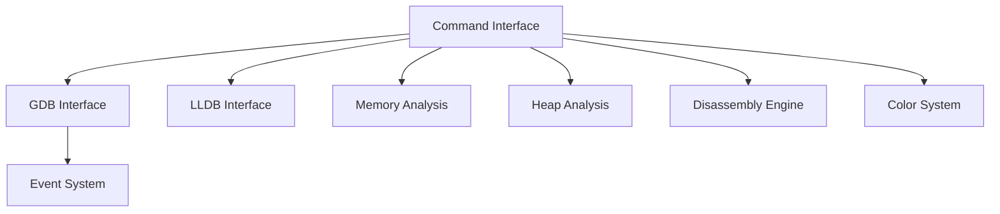

# pwndbg/pwndbg

> GDB and LLDB extension that enriches low-level debugging, for systems engineers and reverse engineers.

## The problem
Bare GDB and LLDB are not very ergonomic for binary analysis: verbose commands, little information displayed by default.

## What it actually does
A Python module loaded into GDB, or a REPL for LLDB. It adds commands (hexdump, memory, heap, disassembly), colored output, TUI components and a configuration and event system. The `pwndbg/dbg/gdb/` and `pwndbg/dbg/lldb/` layers isolate each debugger. LLDB support is described as early and experimental.

## How it is wired

## Trying it
No command documented in the README excerpt: it points to an external installation page. Announced compatibility: GDB 12.1+ with Python 3.10+; LLDB 19+ with Python 3.12+.

## Cost and gotchas
Free. Requires GDB or LLDB installed in a compatible version; 219 open issues.

## What it is not
Not a standalone debugger: it complements GDB/LLDB. A dual-use tool (binary analysis, exploit development) but commonly used for legitimate debugging.

## Alternatives
- GEF: another GDB extension, packaged as a single file.
- PEDA: older GDB extension, single file.
- gdbinit: historical script, single file.

## For you
Watch: valuable if you debug native code (C/C++ extensions of ML libraries, for example), but outside the daily work of a data/MLOps profile.
