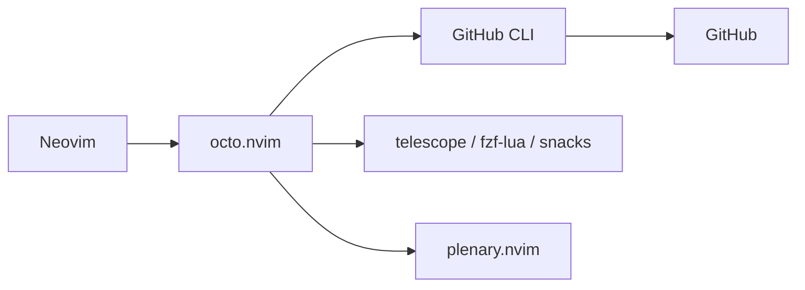

# pwntester/octo.nvim

> Neovim plugin to edit and review GitHub issues, pull requests and discussions from within the editor.

## The problem
Reviewing a PR or answering an issue means leaving the editor for the browser.

## What it actually does
Issues, PRs and discussions open as buffers; `:w` syncs with GitHub. A single command `Octo <object> <action>`. PR review with a file panel and diffs, comments and suggestions, labels, reactions, assignees, notifications, workflow runs. Relies on the `gh` CLI. Supports GitHub Enterprise.

## How it is wired


## Trying it
```bash
gh auth refresh -s read:project
```
```vim
:checkhealth octo
Octo issue list
Octo pr list
```

## Cost and gotchas
Free. Neovim 0.10 or later, an authenticated `gh`, and plenary.nvim is mandatory. Projects v2 requires the token's `read:project` scope.

## What it is not
Not a standalone GitHub client: unusable without Neovim and `gh`. `GITHUB_TOKEN` conflicts with `gh` are a pitfall listed in the FAQ.

## Alternatives
The README mentions diffview.nvim as the inspiration for the review panel.

## For you
Ignore unless you live in Neovim: useful for keyboard-driven PR review, but it is an editor convenience, not a data/AI tool.
