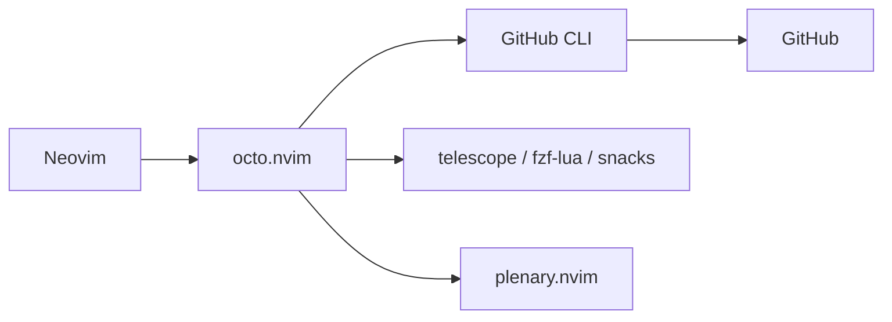

# pwntester/octo.nvim

> Plugin Neovim pour éditer et relire issues, pull requests et discussions GitHub depuis l'éditeur.

## Le problème
Relire une PR ou répondre à une issue oblige à quitter l'éditeur pour le navigateur.

## Ce que ça fait vraiment
Les issues, PR et discussions s'ouvrent comme des buffers ; `:w` synchronise avec GitHub. Commande unique `Octo <objet> <action>`. Revue de PR avec panneau de fichiers et diffs, commentaires et suggestions, labels, réactions, assignés, notifications, runs de workflows. S'appuie sur la CLI `gh`. Prend en charge GitHub Enterprise.

## Comment c'est branché


## Essayer
```bash
gh auth refresh -s read:project
```
```vim
:checkhealth octo
Octo issue list
Octo pr list
```

## Coût et pièges
Gratuit. Neovim 0.10 ou plus, `gh` authentifié, plenary.nvim obligatoire. Projects v2 demande le scope `read:project` du token.

## Ce que ce n'est pas
Pas un client GitHub autonome : inutilisable sans Neovim et `gh`. Les conflits de `GITHUB_TOKEN` avec `gh` sont un piège du FAQ.

## Alternatives
Le README mentionne diffview.nvim comme source d'inspiration du panneau de revue.

## Pour toi
À ignorer sauf si tu vis dans Neovim : utile pour la revue de PR au clavier, mais c'est un confort d'éditeur, pas un outil data/IA.

