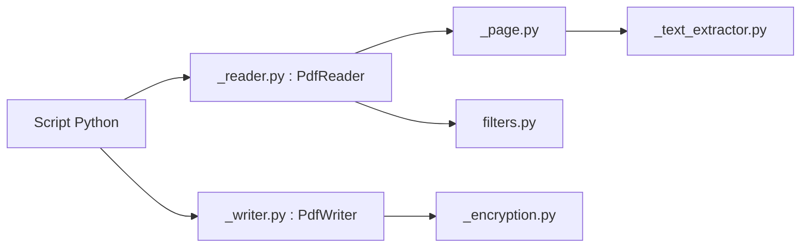

# py-pdf/pypdf

> Pure Python library to read, split, merge and transform PDFs, and extract their text.

## The problem
Handling PDFs in a script (extracting text, assembling pages) without a binary dependency.

## What it actually does
`PdfReader` opens a PDF and exposes pages, text and metadata; `PdfWriter` creates or modifies PDFs: merging, splitting, cropping, page transformations, annotations, encryption and decryption (`crypto` extra for AES). The `pdfly` CLI is built on the library.

## How it is wired


## Trying it
```bash
pip install pypdf
pip install pypdf[crypto]
pytest
```
```python
from pypdf import PdfReader
reader = PdfReader("example.pdf")
text = reader.pages[0].extract_text()
```

## Cost and gotchas
Free. For AES, install the `crypto` extra. The license is "present but not identified by GitHub": to be confirmed.

## What it is not
Not an OCR: it extracts embedded text, not the text of scans. Malformed PDFs can cause problems (hence the requirement for a minimal example in issues).

## Alternatives
- pdfly: CLI built on pypdf.

## For you
Adopt: first building block for ingesting PDFs into a RAG pipeline, installable in one command, with a license to confirm.
