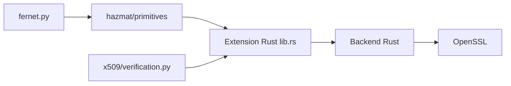

# pyca/cryptography

> Python cryptography library: high-level recipes and low-level primitives.

## The problem
Writing correct encryption by hand is dangerous; a reliable standard foundation is needed.

## What it actually does
Fernet (authenticated symmetric encryption), ciphers, hashes, KDFs, asymmetric keys, serialization, X.509 with verification. The Python code calls a Rust core built on OpenSSL. Aims to be Python's "standard cryptographic library".

## How it is wired


## Trying it
```bash
pip install cryptography
```
```pycon
>>> from cryptography.fernet import Fernet
>>> key = Fernet.generate_key()
>>> f = Fernet(key)
>>> token = f.encrypt(b"A really secret message. Not for prying eyes.")
>>> f.decrypt(token)
```

## Cost and gotchas
Free. Building from source: Rust and OpenSSL required; wheels avoid this. License present but not identified by GitHub.

## What it is not
Not a secrets manager nor a turnkey PKI.

## Alternatives
No alternative named in the README.

## For you
Adopt: an almost unavoidable dependency for encrypting keys, tokens or data in a Python pipeline; still check the license notice.
