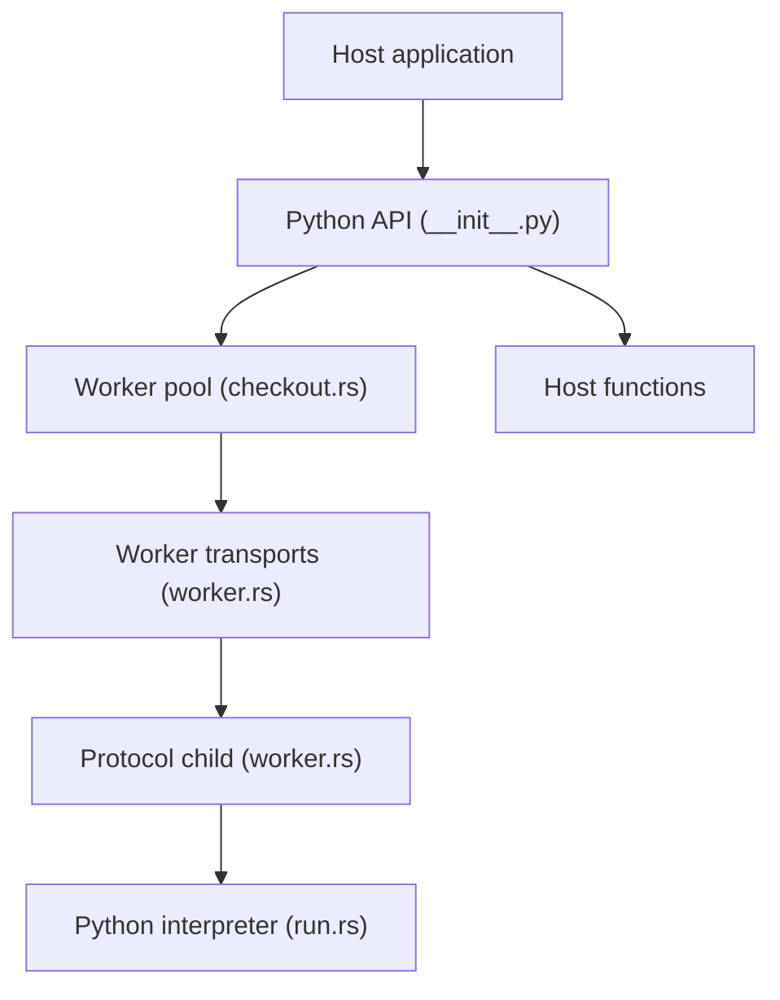

# pydantic/monty

> Python sandbox written in Rust for running LLM-generated code, with isolation and fast startup.

## The problem
Running model-written code in a container costs latency and complexity (about 1,500 ms for a sandbox service according to the README).

## What it actually does
An isolated Python interpreter (a subset): no filesystem, environment variables or network; it reaches the host only through the functions and mounts you provide. A new sandbox takes under a millisecond from a pool. Rust, Python and JavaScript bindings, resource limits, snapshots and type checking. There is also Full Monty, a commercial server that exposes the same sandbox over gRPC.

## How it is wired


## Trying it
```bash
uv add pydantic-monty
npm install @pydantic/monty
cargo add monty
```

## Cost and gotchas
Free for the MIT edition. Only a subset of Python is supported, so generated code may fail on an unimplemented feature. Full Monty is paid.

## What it is not
Not full Python nor OS-level isolation: it is a dedicated interpreter. The README compares it with Docker, Pyodide, WASI and sandbox services, without detailing them here.

## Alternatives
Docker, Pyodide, WASI and sandbox services are compared in the project's documentation.

## For you
Keep an eye on it: very promising for agents' code mode, but young and limited to the supported Python subset.
