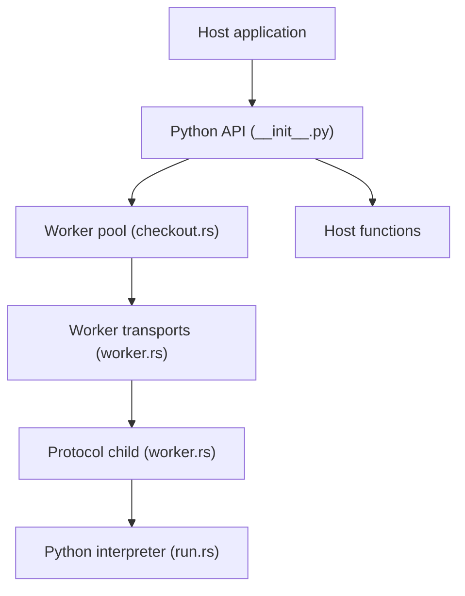

# pydantic/monty

> Bac à sable Python écrit en Rust pour exécuter du code généré par un LLM, avec isolation et démarrage rapide.

## Le problème
Exécuter du code écrit par un modèle dans un conteneur coûte de la latence et de la complexité (environ 1 500 ms pour un service de sandbox selon le README).

## Ce que ça fait vraiment
Un interpréteur Python (sous-ensemble) isolé : pas de système de fichiers, de variables d'environnement ni de réseau ; il ne joint l'hôte que par les fonctions et montages que tu fournis. Un nouveau bac à sable prend moins d'une milliseconde depuis un pool. Liaisons Rust, Python et JavaScript, limites de ressources, instantanés et vérification de types. Il existe aussi Full Monty, serveur commercial qui expose le même bac à sable en gRPC.

## Comment c'est branché


## Essayer
```bash
uv add pydantic-monty
npm install @pydantic/monty
cargo add monty
```

## Coût et pièges
Gratuit pour l'édition MIT. Seul un sous-ensemble de Python est pris en charge, donc le code généré peut échouer sur une fonction non implémentée. Full Monty est payant.

## Ce que ce n'est pas
Pas un Python complet ni une isolation au niveau du système d'exploitation : c'est un interpréteur dédié. Le README compare à Docker, Pyodide, WASI et aux services de sandbox, sans les détailler ici.

## Alternatives
Docker, Pyodide, WASI et les services de sandbox sont comparés dans la documentation du projet.

## Pour toi
À surveiller : très prometteur pour le mode code des agents, mais jeune et limité au sous-ensemble Python supporté.

