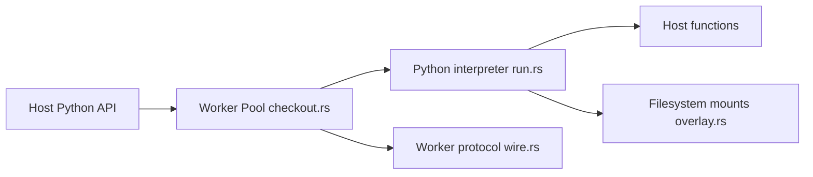

# pydantic/monty

> Bac à sable Python écrit en Rust pour exécuter du code généré par des IA, pour développeurs d'agents.

## Le problème
Un sandbox par conteneur ou service coûte de la latence et de la complexité (environ 1500 ms annoncés par sandbox service).

## Ce que ça fait vraiment
Interpréteur d'un sous-ensemble de Python 3.14 isolé : pas de système de fichiers, de variables d'environnement ni de réseau, sauf via les fonctions et montages que tu passes. Un nouveau sandbox prend moins de 1 ms depuis un pool, selon le README. Existe en paquet Python, npm et Rust ; un serveur commercial « Full Monty » l'expose en WebSocket.

## Comment c'est branché


## Essayer
```bash
uv add pydantic-monty
npm install @pydantic/monty
cargo add monty
```
Exemple Python dans le README avec `Monty()`, `pool.checkout()` et `session.feed_run(...)`.

## Coût et pièges
Le paquet MIT est gratuit ; Full Monty est commercial. Seul un sous-ensemble de Python est supporté (page des limites).

## Ce que ce n'est pas
Pas un Python complet ni un conteneur : le code ne voit que ce que l'hôte expose.

## Alternatives
- Docker, Pyodide, WASI et services de sandbox : comparés dans la documentation, non détaillés ici.

## Pour toi
À adopter pour exécuter du code généré par LLM : gain de latence net, MIT, et l'éditeur est aussi derrière Pydantic AI.

