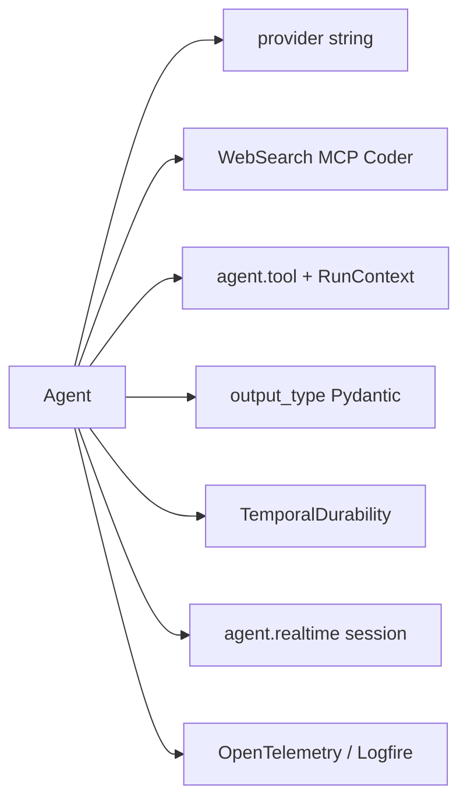

# pydantic/pydantic-ai

> Typed Python SDK for writing LLM agents, with validated output and an interchangeable model.

## The problem
An LLM agent returns text: your code expects a structure, and discovers the error at runtime.
And switching provider generally forces you to rewrite the call loop and the tool definitions.

## What it actually does
A typed agent loop where the model is changed with a string: `'openai:gpt-5.6-sol'`, `'anthropic:claude-fable-5'`.
`output_type=Sentiment` guarantees that `result.output` is a validated Pydantic instance.
The `@agent.tool` decorator turns signature and docstring into a tool schema, with a `RunContext` for dependencies.
The same definition runs as a CLI, web chat, real-time voice, GitHub Actions or durable execution.

## How it is wired


## Trying it
```bash
uv add pydantic-ai
uvx --with pydantic-ai-harness clai -a pydantic_ai_harness.coder:coder_agent -m anthropic:claude-fable-5
```
Extras depending on usage: `uv add "pydantic-ai[temporal]"`, `uv add "pydantic-ai[openai-realtime]"`,
`uv add pydantic-ai pydantic-ai-harness` for the coding agent.

## Cost and gotchas
Every run consumes tokens at the provider you choose: the bill is yours.
A built-in `'test'` model lets you start without a key, but does not replace a real evaluation.

## What it is not
Not a platform: Logfire, the Gateway and Monty are separate products, the library does not depend on them.
Not a graph engine nor an evaluation framework: Pydantic Graph and Pydantic Evals are separate packages.
Not a vendor lock-in, but not a guarantee either that every feature exists on every model.

## Alternatives
`LangChain`, `Google ADK`, `Claude Agent SDK` — cited in the project's comparisons page.
`Pydantic AI Harness` — if you want memory, guardrails and sub-agents already assembled.

## For you
This is the agent foundation I would take by default in Python: strict typing, and the model stays a variable.
