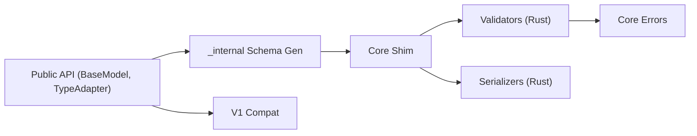

# pydantic/pydantic

> Python data validation library based on type annotations, for API and pipeline developers.

## The problem
External data (JSON, forms, configs) arrives as strings or dubious types. Without validation, errors surface late and far from their cause.

## What it actually does
You declare a model with type annotations; Pydantic coerces and validates the input, then raises structured errors. Internally, the Python code builds a validation schema passed to `pydantic-core`, a compiled Rust extension that validates and serializes. The README states that V1 remains available through `pydantic.v1` to migrate in stages.

## How it is wired


## Trying it
```bash
pip install -U pydantic
```
```python
from pydantic import BaseModel

class User(BaseModel):
    id: int
    name: str = 'John Doe'

user = User(id='123')
```

## Cost and gotchas
Free. V1 to V2 migration: expect API breakages; the README suggests the import `from pydantic import v1 as pydantic_v1`. 578 open issues.

## What it is not
It is not an ORM or a web framework. The README promotes Logfire (the publisher's observability product), which is a separate offer.

## Alternatives
- No alternative named in the README.

## For you
Adopt: it is the standard validation building block for configs, API schemas and LLM outputs in Python, the license is MIT and the repository is actively pushed.
