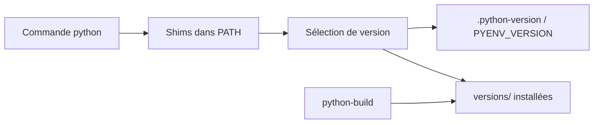

# pyenv/pyenv

> Python version manager made of shell scripts, for anyone juggling several interpreters.

## The problem
One project requires Python 3.10, another 3.12: the system Python is not enough and switching by hand breaks things.

## What it actually does
Puts a shims folder at the front of the `PATH`. Each shim redirects `python`, `pip`… to the chosen version (`PYENV_VERSION` variable, local or parent `.python-version` file, then global version). `pyenv install` compiles versions from source. Several versions can be active at the same time (useful with tox).

## How it is wired


## Trying it
```bash
curl -fsSL https://pyenv.run | bash
pyenv init --install
pyenv install 3.10.4
pyenv global 3.10.4
```

## Cost and gotchas
Free. Versions are compiled: you must install the build dependencies first. Does not manage virtualenvs (pyenv-virtualenv plugin). No native Windows support (pyenv-win fork cited).

## What it is not
Not a package manager nor a virtual environment manager. Does not work natively on Windows.

## Alternatives
- pyenv-win: for native Windows.
- pyenv-virtualenv: to automate virtualenvs.

## For you
Adopt: the basis of any data/AI workstation that must reproduce several Python versions; light, stable, no dependencies.
