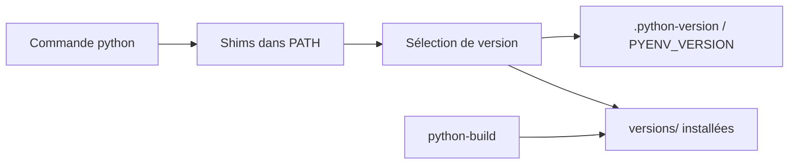

# pyenv/pyenv

> Gestionnaire de versions Python en scripts shell, pour qui jongle entre plusieurs interpréteurs.

## Le problème
Un projet exige Python 3.10, un autre 3.12 : le Python du système ne suffit pas et la bascule à la main casse des choses.

## Ce que ça fait vraiment
Place un dossier de shims en tête du `PATH`. Chaque shim redirige `python`, `pip`… vers la version choisie (variable `PYENV_VERSION`, fichier `.python-version` local ou parent, puis version globale). `pyenv install` compile les versions depuis les sources. Plusieurs versions peuvent être actives en même temps (utile avec tox).

## Comment c'est branché


## Essayer
```bash
curl -fsSL https://pyenv.run | bash
pyenv init --install
pyenv install 3.10.4
pyenv global 3.10.4
```

## Coût et pièges
Gratuit. Les versions sont compilées : il faut installer les dépendances de build avant. Ne gère pas les virtualenv (plugin pyenv-virtualenv). Pas de support Windows natif (fork pyenv-win cité).

## Ce que ce n'est pas
Pas un gestionnaire de paquets ni d'environnements virtuels. Ne fonctionne pas nativement sous Windows.

## Alternatives
- pyenv-win : pour Windows natif.
- pyenv-virtualenv : pour automatiser les virtualenv.

## Pour toi
Adopter : base de tout poste data/IA qui doit reproduire plusieurs versions de Python ; léger, stable, sans dépendance.

