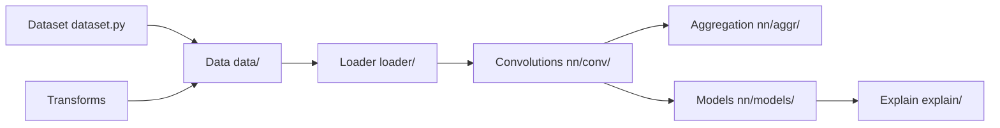

# pyg-team/pytorch_geometric

> PyTorch library for building and training graph neural networks (GNNs).

## The problem
Graph data (networks, molecules, point clouds) does not fit into standard PyTorch layers; hand-written message passing is slow and tedious.

## What it actually does
`MessagePassing` API to write your own layers; dozens of ready-made layers (GCN, GAT, SAGE, GIN, Transformer…) and pooling.
`Data` structures, benchmark datasets, transforms, sub-sampling loaders (NeighborLoader, ClusterGCN, GraphSAINT).
Complete models (SchNet, Node2Vec, VGAE, GNNExplainer…) and heterogeneous graphs.
`torch.compile` support, multi-GPU; optional C++/CUDA extensions (pyg-lib, torch-scatter).

## How it is wired


## Trying it
```bash
pip install torch_geometric
pip install pyg-nightly
```

## Cost and gotchas
Free (MIT). The optional extensions must match the PyTorch/CUDA versions exactly. Python 3.10 to 3.14.

## What it is not
Not a graph database nor a visualization tool. Not independent of PyTorch.

## Alternatives
No alternative named in the README.

## For you
Adopt: the reference for any GNN project in PyTorch, installable without native dependencies since 2.3.
