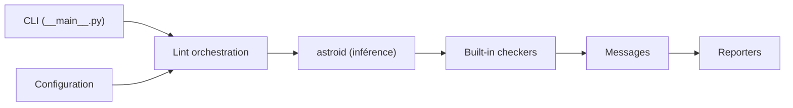

# pylint-dev/pylint

> Static Python analyzer that infers the values in code to spot errors and bad practices.

## The problem
Bugs and style deviations slip through human review; linters that rely on type annotations miss some when the code is lightly typed.

## What it actually does
Analyzes code without running it, relying on astroid to infer what each node refers to. Many rules, some disabled by default; configurable; plugins for third-party libraries (pylint-django, pylint-pydantic). Includes pyreverse (package and class diagrams) and symilar (duplicate code). Slower than other linters, which the README openly accepts.

## How it is wired


## Trying it
```bash
pip install pylint
pip install pylint[spelling]
```

## Cost and gotchas
Free. Acknowledged slowness. On a legacy project, the README advises starting with `--errors-only` and then `--disable=C,R`. GPL-2.0 license (icons under CC BY-SA 4.0).

## What it is not
Not a type checker nor a formatter: the README advises combining it with mypy, black, etc. It may flag deliberate choices.

## Alternatives
ruff: much faster, with auto-fix. flake8: a framework for writing your own rules.

## For you
Adopt it in CI for pipeline Python code: deeper than ruff alone, provided you accept the slowness and tune the messages.
