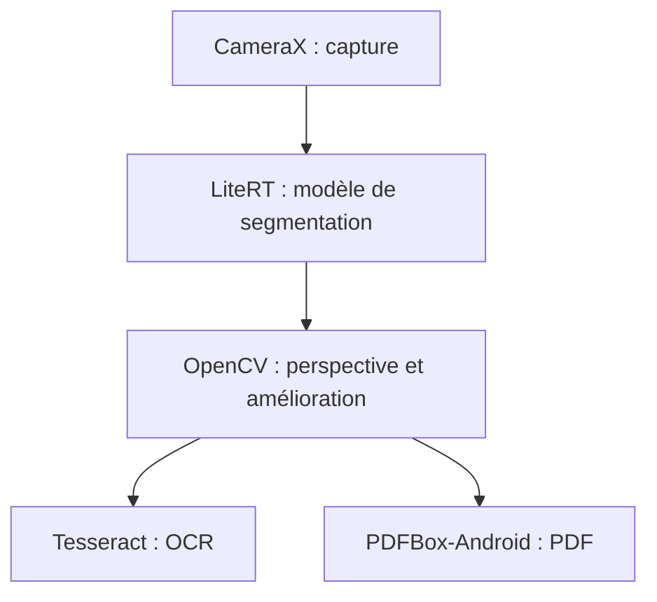

# pynicolas/FairScan

> Android app that scans documents to PDF, simple, local and tracking-free.

## The problem
Scanning apps often force cloud use, ads or tedious manual settings.

## What it actually does
Detects the document with a segmentation model trained for the purpose, corrects the perspective, enhances the image and produces a PDF in a few seconds. All processing stays on the device. An experimental Android intent mode (`org.fairscan.app.action.SCAN_TO_PDF`) lets other apps request a scan.

## How it is wired
Simplified diagram based on the fiche, no diagram provided.


## Trying it
```bash
./gradlew clean check assembleRelease
./gradlew clean check :app:bundleRelease
```

## Cost and gotchas
Free, Android 8.0 or later with a camera. The build downloads the model via `download-tflite.gradle.kts`. The intent contract may change with no compatibility guarantee.

## What it is not
No fine-grained settings or all the features of other scanning apps, by design. It is not a cloud service.

## Alternatives
No alternative named in the README.

## For you
Ignore for your line of work: a consumer app; only the segmentation model and its public dataset may interest you as an example of embedded AI.
