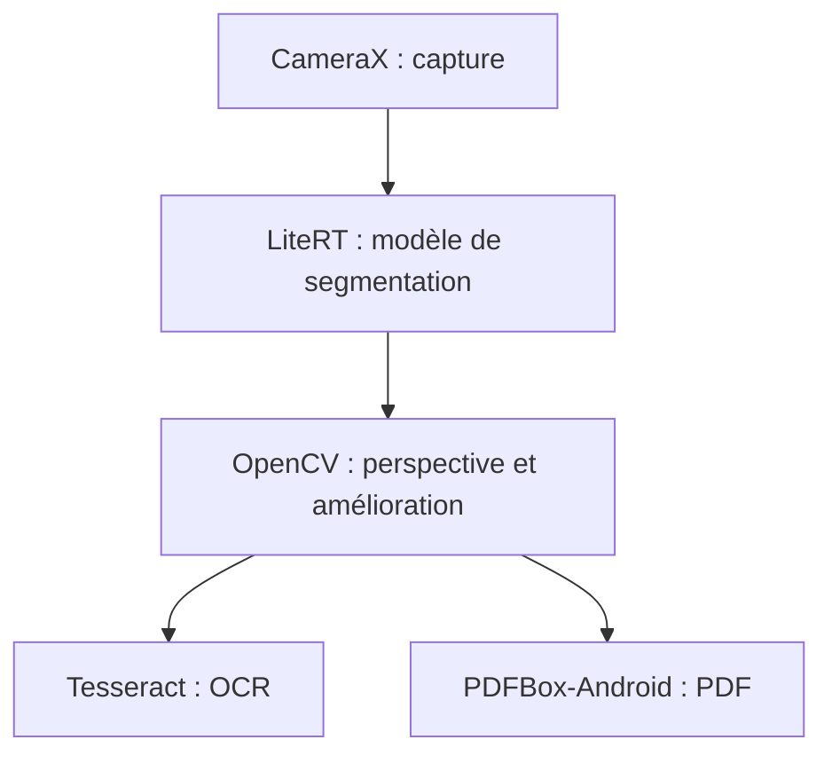

# pynicolas/FairScan

> Application Android de numérisation de documents en PDF, simple, locale et sans pistage.

## Le problème
Les applications de scan imposent souvent du cloud, des publicités ou des réglages manuels pénibles.

## Ce que ça fait vraiment
Détecte le document avec un modèle de segmentation entraîné pour l'occasion, corrige la perspective, améliore l'image et produit un PDF en quelques secondes. Tout le traitement reste sur l'appareil. Un mode expérimental par intent Android (`org.fairscan.app.action.SCAN_TO_PDF`) permet à d'autres applications de demander un scan.

## Comment c'est branché
Schéma simplifié d'après la fiche, sans diagramme fourni.


## Essayer
```bash
./gradlew clean check assembleRelease
./gradlew clean check :app:bundleRelease
```

## Coût et pièges
Gratuit, Android 8.0 ou plus avec caméra. La compilation télécharge le modèle via `download-tflite.gradle.kts`. Le contrat d'intent peut changer sans garantie de compatibilité.

## Ce que ce n'est pas
Pas de réglages fins ni toutes les fonctions des autres applications de scan, c'est voulu. Ce n'est pas un service cloud.

## Alternatives
Aucune alternative nommée dans le README.

## Pour toi
À ignorer pour ton métier : une application grand public ; seul le modèle de segmentation et son jeu de données publics peuvent t'intéresser comme exemple d'IA embarquée.

