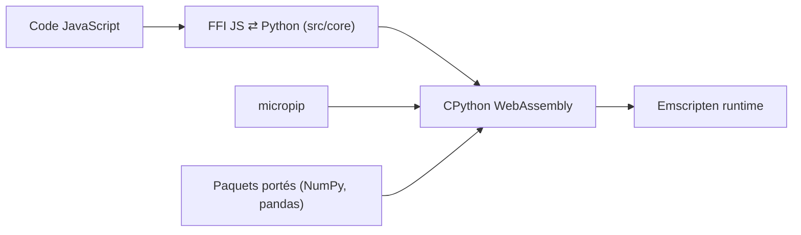

# pyodide/pyodide

> Python distribution compiled to WebAssembly to run code and packages in the browser or Node.js.

## The problem
Running Python (NumPy, pandas, scikit-learn) on the client side, with no server or installation.

## What it actually does
A port of CPython to WebAssembly/Emscripten, with a JavaScript ⇄ Python call interface (errors, async/await), package loading via `micropip` (pure wheels from PyPI) and many already-ported packages with C/C++/Rust extensions (NumPy, pandas, SciPy, Matplotlib, scikit-learn). The project includes a patched CPython, the call interface, the interpreter management code and a cross-compilation toolchain.

## How it is wired

## Trying it
No command documented. The README offers an online REPL with no installation, a hosted distribution or a download from the releases page, plus the documentation for bundlers.

## Cost and gotchas
Free. MPL-2.0 license (file-level copyleft). Only pure or already-ported packages work; the README does not detail performance or memory limits in the browser.

## What it is not
Not a replacement for native Python for model training. No longer the Iodide notebook environment, which was abandoned; the README points to other environments.

## Alternatives
The README cites no direct alternative; it points to Pyodide-based notebook environments.

## For you
Watch: interesting for interactive data demos without a backend, but niche compared to a classic Python environment.
