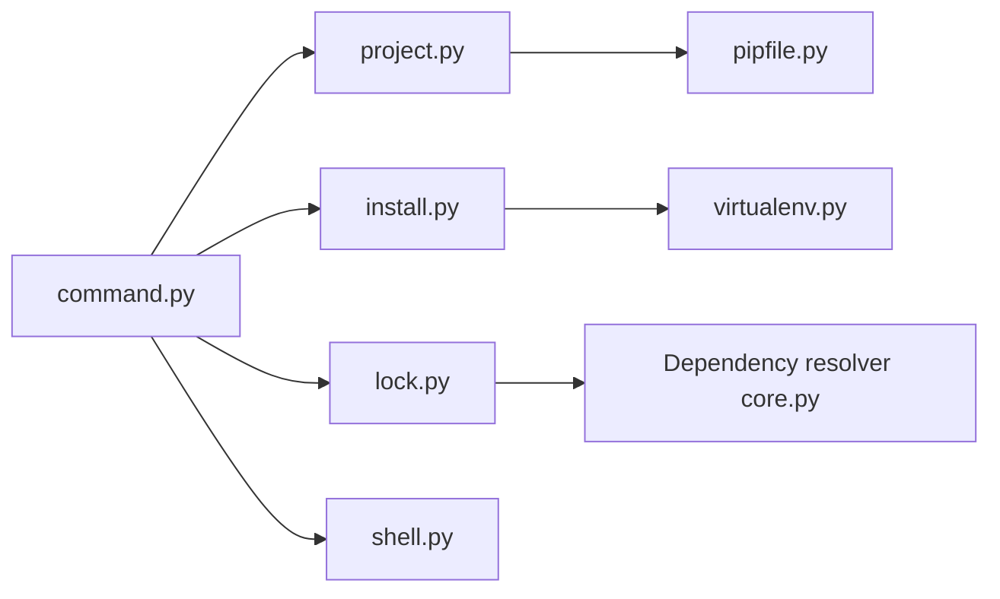

# pypa/pipenv

> Python tool that ties pip and virtualenv together with a Pipfile and a lock file, for application developers.

## The problem
Managing pip, virtualenv and a requirements.txt by hand, with non-reproducible builds.

## What it actually does
Creates and manages one virtual environment per project, adds or removes packages in the `Pipfile`, generates `Pipfile.lock` with hashes verified at install time. Offers `graph`, `check` (vulnerabilities), `run`, `shell`, `sync`, `requirements`. Loads `.env` files. Installs Python versions if pyenv or asdf are present.

## How it is wired


## Trying it
```bash
pip install --user pipenv
pipenv install
pipenv install --dev
pipenv lock
pipenv run python hello.py
pipenv shell
```

## Cost and gotchas
Free. Python 3.10 or later. Completion changed starting with version 2026.5.0: the old `_PIPENV_COMPLETE` variable no longer works.

## What it is not
Not a packaging tool for publishing a library: it targets applications. The README does not compare its speed with other tools.

## Alternatives
- pip and virtualenv: what it replaces by combining them.
- pyenv and asdf: cited for installing Python versions.

## For you
Watch: useful for freezing a data project's environment, but check whether another manager has already replaced it in your team.
