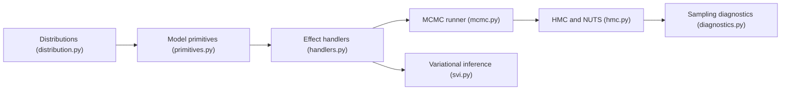

# pyro-ppl/numpyro

> Probabilistic programming library on JAX, with MCMC and variational inference, for statisticians and data scientists.

## The problem
Hierarchical Bayesian models are slow to sample without compilation or an accelerator.

## What it actually does
You write models with Pyro's primitives (`sample`, `param`, `plate`) and distributions close to `torch.distributions`. JAX compiles everything: NUTS and HMC (compiled integration steps), MixedHMC, HMCECS, BarkerMH, nested sampler, variational inference with automatic guides, Stein VI. Effect handlers allow custom algorithms. No global state or global seed: an explicit PRNG key is required.

## How it is wired


## Trying it
```bash
pip install numpyro
pip install 'numpyro[cpu]'
pip install 'numpyro[cuda12]' -f https://storage.googleapis.com/jax-releases/jax_cuda_releases.html
```
The README is truncated at the installation from source (after `cd numpyro`).

## Cost and gotchas
Free. Windows untested; with CUDA jaxlib, JAX uses the GPU by default (`numpyro.set_platform("cpu")` to force the CPU). The README warns of possible API changes.

## What it is not
Not a copy-paste of Pyro models: torch code must be rewritten in `jax.numpy`, in a functional style.

## Alternatives
- Pyro: same API on the PyTorch side.

## For you
Adopt for fast Bayesian inference in Python: recent activity, familiar API if you know Pyro.
