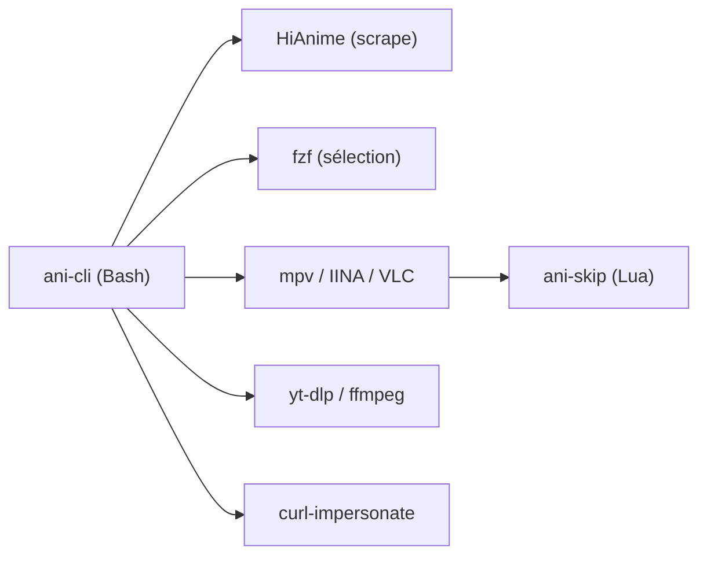

# pystardust/ani-cli

> Bash script that searches, plays and downloads anime from the terminal, for CLI fans.

## The problem
Watching streamed anime means going through sites full of ads and pop-ups. Here, everything is done from the keyboard.

## What it actually does
A single `ani-cli` script scrapes the HiAnime site with curl, grep and sed, shows titles and episodes in fzf, resolves the stream URL, then delegates playback to mpv (IINA or VLC optionally). The `-d` option hands the download to yt-dlp, with ffmpeg as a fallback. If Cloudflare blocks it, curl-impersonate is needed.

## How it is wired


## Trying it
```bash
sudo apt install ani-cli          # Debian 13/unstable
yay -S ani-cli                    # Arch (AUR)
brew tap pystardust/ani-cli https://github.com/pystardust/ani-cli.git
sudo ani-cli -U                   # mise à jour
ani-cli -q 1080                   # choisir la résolution
ani-cli onepiece -d -e 1-1000     # téléchargement en lot
```

## Cost and gotchas
Free. Depends on a scraped site: an outage or a Cloudflare block breaks the tool. On Windows, Git Bash or WSL is required, with several documented pitfalls.

## What it is not
Not a standalone player: it needs mpv and fzf. No choice of source or dubbing language. The README says nothing about the legal status of the streams.

## Alternatives
- ani-cli-rs: Rust port with two Anikoto catalogs.
- anipy-cli: rewrite in Python.
- Curd: in Go, with Anilist, Discord RPC and intro skipping.

## For you
Ignore: a hobby tool unrelated to data/AI/MLOps work, and fragile because it is tied to a scraped site.
