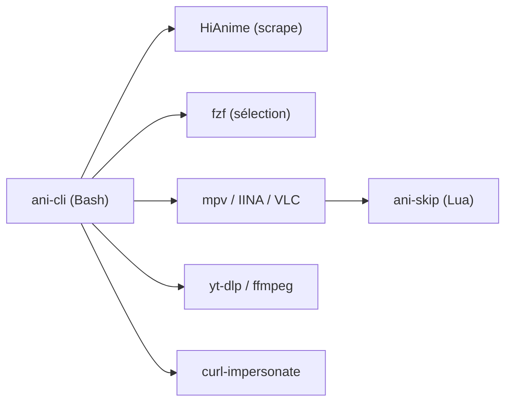

# pystardust/ani-cli

> Script Bash qui cherche, lit et télécharge des animes depuis le terminal, pour les amateurs de CLI.

## Le problème
Regarder un anime en streaming passe par des sites chargés de pubs et de pop-ups. Ici, tout se fait au clavier.

## Ce que ça fait vraiment
Un seul script `ani-cli` scrape le site HiAnime avec curl, grep et sed, affiche titres et épisodes dans fzf, résout l'URL du flux, puis délègue la lecture à mpv (IINA, VLC en option). L'option `-d` confie le téléchargement à yt-dlp, avec ffmpeg en secours. Si Cloudflare bloque, il faut curl-impersonate.

## Comment c'est branché


## Essayer
```bash
sudo apt install ani-cli          # Debian 13/unstable
yay -S ani-cli                    # Arch (AUR)
brew tap pystardust/ani-cli https://github.com/pystardust/ani-cli.git
sudo ani-cli -U                   # mise à jour
ani-cli -q 1080                   # choisir la résolution
ani-cli onepiece -d -e 1-1000     # téléchargement en lot
```

## Coût et pièges
Gratuit. Dépend d'un site scrapé : une panne ou un blocage Cloudflare casse l'outil. Sous Windows, il faut Git Bash ou WSL, avec plusieurs pièges documentés.

## Ce que ce n'est pas
Pas un lecteur autonome : il lui faut mpv et fzf. Pas de choix de source ni de langue de doublage. Le README ne dit rien sur le statut légal des flux.

## Alternatives
- ani-cli-rs : portage Rust avec deux catalogues Anikoto.
- anipy-cli : réécriture en Python.
- Curd : en Go, avec Anilist, Discord RPC et saut d'intro.

## Pour toi
Ignorer : outil de loisir sans rapport avec un travail data/IA/MLOps, et fragile car lié à un site scrapé.

