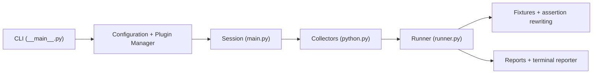

# pytest-dev/pytest

> Python testing framework: simple assertions, modular fixtures, automatic discovery, plugins.

## The problem
Writing tests with heavy code (`self.assert*`) and poor error messages, without clean handling of shared resources.

## What it actually does
Discovers test files and functions, rewrites `assert` statements to show failure details, provides parametrizable fixtures, selection markers, a cache between runs and adapters for `unittest` and `doctest`. More than 1,300 external plugins according to the README. Python 3.10+ or PyPy3.

## How it is wired


## Trying it
```bash
pytest
```
The README shows an example `test_sample.py` file with `assert inc(3) == 5` and the displayed failure.

## Cost and gotchas
Free. Installation is not detailed in the README (it refers to the documentation). 819 open issues; assertion rewriting can be surprising when debugging.

## What it is not
It is not a model evaluation or load testing tool; it runs tests and reports, the rest comes from plugins.

## Alternatives
The README mentions `unittest` and `trial`, whose suites it runs directly.

## For you
Adopt: the de facto standard for testing data code, pipelines and model APIs, with a very rich plugin ecosystem and active maintenance.
