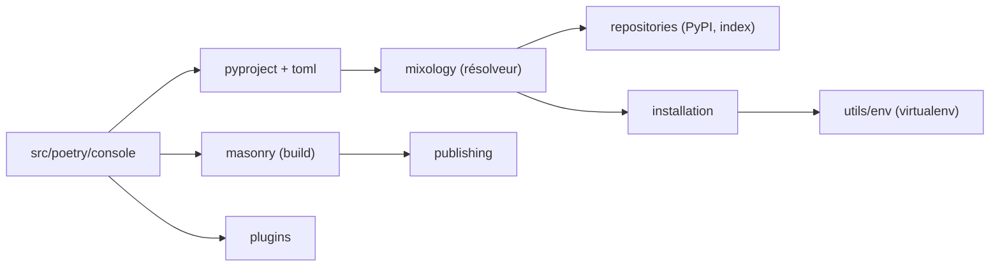

# python-poetry/poetry

> Python dependency management and packaging tool, driven by a single pyproject.toml file.

## The problem
A Python project scatters its metadata across setup.py, requirements.txt, setup.cfg, MANIFEST.in and Pipfile, and environments diverge from one machine to another.

## What it actually does
Replaces these files with a single pyproject.toml: dependencies, optional groups (docs, lint), extras, scripts, git dependencies. A version resolver (mixology module) computes a consistent set, then the installer populates a virtual environment. The tool also builds packages and publishes them, and is extended by plugins (requirements.txt export, bundle).

## How it is wired

## Trying it
No shell command in the README: it points to the install.python-poetry.org script and the installation documentation on python-poetry.org.

## Cost and gotchas
Free. The repository has 576 open issues; the README handles them by calling for contributions. The README examples assume poetry-core >= 2.0.

## What it is not
Not a Python version manager: it relies on an existing interpreter. The README does not document the commands, everything is in the external docs.

## Alternatives
No alternative cited in the README.

## For you
Adopt: a single pyproject.toml and version locking make training and deployment environments reproducible.
