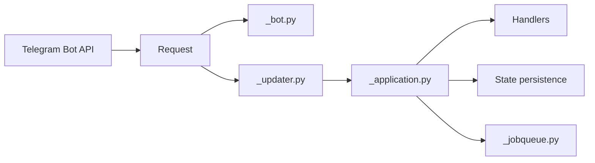

# python-telegram-bot/python-telegram-bot

> Asynchronous Python client for the Telegram Bot API, with an event framework for building bots.

## The problem
Calling the Telegram Bot API by hand means handling serialization, polling/webhooks, message routing and conversation state.

## What it actually does
Covers the whole Bot API 10.0 in typed Python objects; `Bot` serves as the client facade on top of `HTTPXRequest`.
`telegram.ext` adds `Application`/`Updater`, handlers (commands, callbacks…), persistence, `JobQueue` and a rate limiter.
Based on asyncio, not thread-safe; Python 3.10+.
Single mandatory dependency: httpx; the rest in optional extras.

## How it is wired


## Trying it
```bash
pip install python-telegram-bot --upgrade
pip install "python-telegram-bot[all]"
```

## Cost and gotchas
Free; you must create a bot on the Telegram side. Webhooks and JobQueue require the extras (tornado, APScheduler).

## What it is not
Not thread-safe. The catalog says GPL-3.0 while the README says LGPL-3: to be clarified if you redistribute a modified version.

## Alternatives
No alternative named in the README.

## For you
Adopt: to expose a model or MLOps alerts in Telegram, it is the most mature and typed library, an active community project since 2015.
