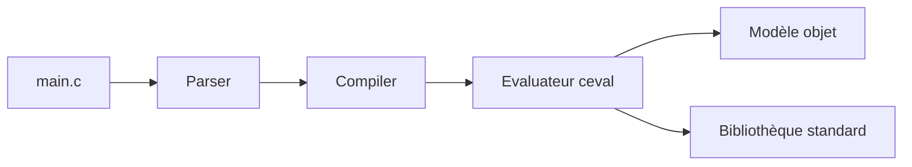

# python/cpython

> Source code of the reference Python interpreter and its standard library.

## The problem
You need an official Python interpreter, or its code, to run, understand or fix the language.

## What it actually does
The repository contains the interpreter (parsing, compilation to bytecode, evaluation loop), the object model, the built-in functions and the standard library (import, asyncio, threading, multiprocessing, sockets, HTTP server, email). The README describes version 3.16.0 alpha 0: this is the development branch, with an optimized build (PGO, LTO) and a test suite.

## How it is wired


## Trying it
```bash
./configure
make
make test
sudo make install
```

## Cost and gotchas
Building requires third-party libraries depending on the platform (see the developer guide). `make install` creates `python3`: use `make altinstall` to coexist with another version.

## What it is not
It is not a ready-to-use installer: to use Python, take the packages from python.org. The main branch is an alpha, not for production.

## Alternatives
No alternative named in the README.

## For you
Adopt (via the official installers): it is the foundation of your stack; the repository is mainly for reading or contributing.
