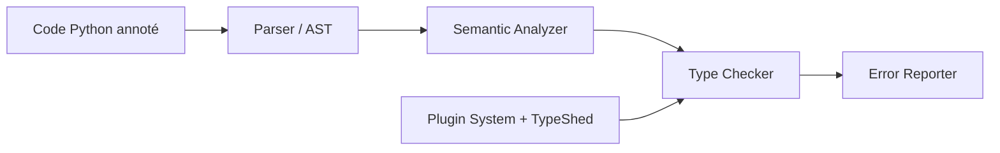

# python/mypy

> Static type checker for Python, to catch errors before runtime.

## The problem
Python only reports type errors at runtime, often late in a data or training pipeline.

## What it actually does
From type annotations (PEP 484), mypy analyzes the code without running it and flags inconsistent uses. It supports gradual typing: you annotate progressively. A daemon mode (`dmypy`) speeds up incremental checks on large repositories. Mypy is itself compiled with mypyc, about 4 times faster than the interpreted version, according to the README. Integrations: VS Code, Vim, Emacs, PyCharm, pre-commit.

## How it is wired


## Trying it
```bash
python3 -m pip install -U mypy
mypy PROGRAM
dmypy run -- PROGRAM
python3 -m pip install --no-binary mypy -U mypy
```

## Cost and gotchas
Free. A license is present but not identified by GitHub: check it in the LICENSE file. The checks do not block execution. With pre-commit, the mirror version limits the analysis of third-party dependencies.

## What it is not
Not a runtime check: annotations remain like comments for the interpreter. The tracker has more than 3,000 open issues.

## Alternatives
No alternative cited in the README.

## For you
Adopt: zero cost and a direct gain in the reliability of ML scripts and libraries; just check the exact license.
