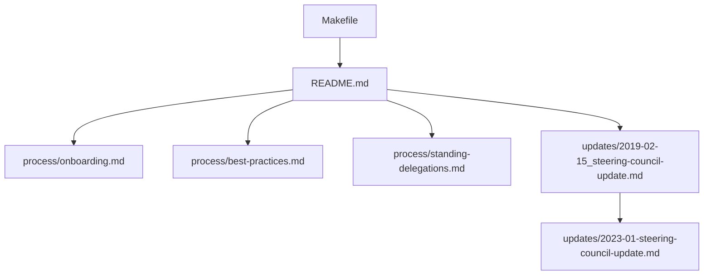

# python/steering-council

> Repository of the Python governance council: meeting minutes, processes and office hours.

## The problem
The Python community needs a public place to follow the council's decisions and rules.

## What it actually does
The README serves as an index to the process documents (member onboarding, best practices, standing delegations) and to the dated minutes. A Makefile regenerates the list of updates. It lists the reference PEPs (1, 13, 8001, 8016, 8100 to 8107) and the 2026 office hours.

## How it is wired

## Trying it
No command documented.

## Cost and gotchas
No cost. Meetings by appointment via Google Calendar, 3 days in advance.

## What it is not
Not code nor a Python library: governance documentation.

## Alternatives
No alternative named.

## For you
Ignore: useful only as a watch on Python governance, with no operational use.
