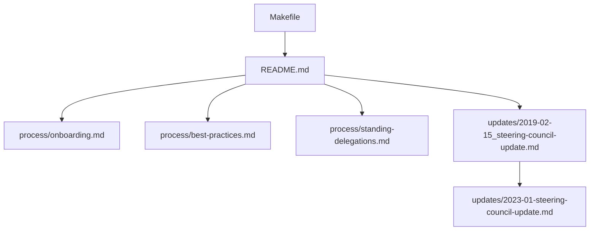

# python/steering-council

> Dépôt du conseil de gouvernance de Python : comptes rendus, processus et heures de permanence.

## Le problème
La communauté Python a besoin d'un lieu public pour suivre les décisions et les règles du conseil.

## Ce que ça fait vraiment
Le README sert d'index vers les documents de processus (intégration des membres, bonnes pratiques, délégations permanentes) et vers les comptes rendus datés. Un Makefile régénère la liste des mises à jour. Il liste les PEP de référence (1, 13, 8001, 8016, 8100 à 8107) et les permanences de 2026.

## Comment c'est branché

## Essayer
Aucune commande documentée.

## Coût et pièges
Aucun coût. Rendez-vous sur rendez-vous via Google Calendar, 3 jours à l'avance.

## Ce que ce n'est pas
Pas du code ni une bibliothèque Python : de la documentation de gouvernance.

## Alternatives
Aucune alternative nommée.

## Pour toi
À ignorer : utile seulement comme veille sur la gouvernance de Python, sans usage opérationnel.

