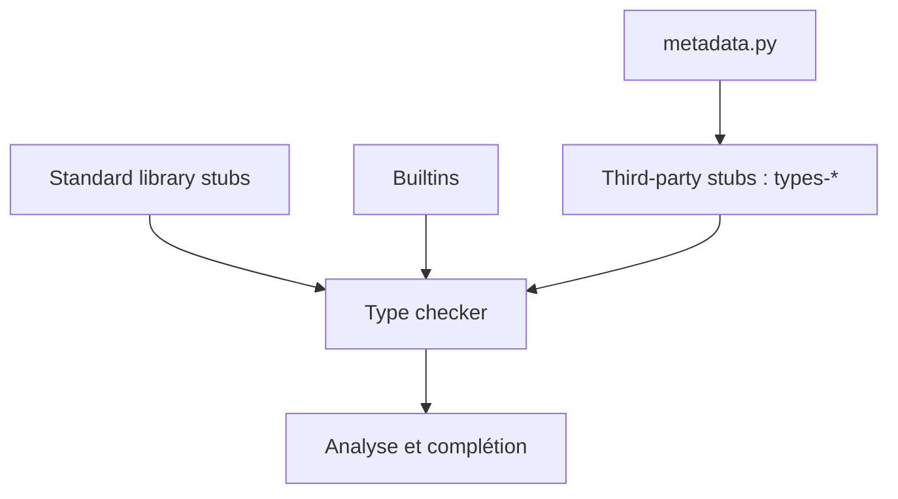

# python/typeshed

> External type annotations for the Python standard library and third-party packages, consumed by type checkers.

## The problem
Type checkers need types for unannotated code: the stdlib and many third-party libraries.

## What it actually does
Provides stub files for the stdlib and builtins, bundled with the type checkers, and for third-party packages, published on PyPI as `types-*`. Supports Python 3.10 to 3.14. Also provides the `_typeshed` package for utility types.

## How it is wired


## Trying it
```bash
pip install types-html5lib types-requests
```

## Cost and gotchas
Free. Stubs can lag behind the library; the README describes three versioning strategies (same bounds, pin, no pin). An update can break type checking. The license is present but not identified by GitHub.

## What it is not
Not a type checker. Stub problems are reported here, not to the project being described.

## Alternatives
- mypy, pyright, PyCharm: these are the type checkers that consume these stubs, not replacements.

## For you
Adopt: you already use it indirectly through your type checker; install the `types-*` packages useful to your pipeline code.
