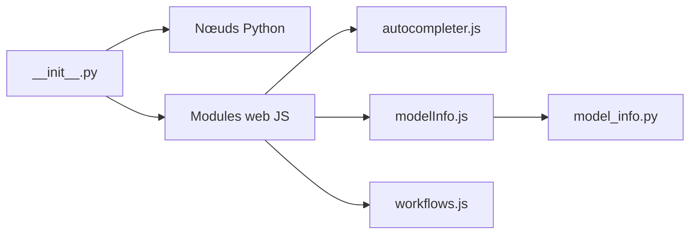

# pythongosssss/ComfyUI-Custom-Scripts

> Collection of small ComfyUI interface improvements: autocompletion, model previews, graph tools.

## The problem
The ComfyUI graph editor lacks comfort: finding a node, previewing a LoRA, tidying a graph.

## What it actually does
Adds autocompletion of embeddings and words, image previews for checkpoints and LoRAs, a model information sheet, nodes (math expression, preset text, string function, repeater), graph auto-arrange, colors, snapping, image feed, sound notification. The script installs everything automatically.

## How it is wired


## Trying it
```bash
git clone https://github.com/pythongosssss/ComfyUI-Custom-Scripts.git
git pull
```
Clone into `custom_nodes`; `git pull` to update.

## Cost and gotchas
Free. Uses symbolic links or junctions; uninstalling also requires deleting `web/extensions/pysssss/CustomScripts`. Some features are marked "Testing" or "WIP". 204 open issues.

## What it is not
No new models: interface comfort only. The WD14 Tagger has moved to another repository.

## Alternatives
ComfyUI-WD14-Tagger (tagger moved, cited in the README).

## For you
Handy if you spend time in ComfyUI; otherwise irrelevant: watch.
