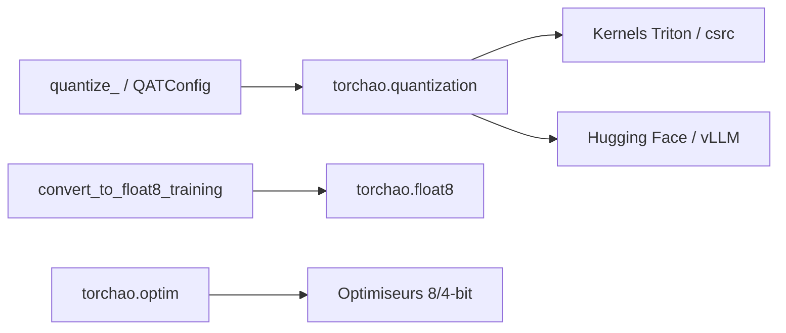

# pytorch/ao

> Quantization and low-precision training for PyTorch: int4, float8, QAT, memory-efficient optimizers.

## The problem
Serving or training large models often exceeds the available GPU memory and budget.

## What it actually does
`quantize_` applies a configuration (int4, int8, float8) to a model; quantization is compatible with `torch.compile` and FSDP2. Recipes for QAT (with TorchTune), float8 training, quantized optimizers (AdamW8bit, 4bit, Fp8) and CPU offload. Integrations with Transformers, diffusers, vLLM, SGLang, ExecuTorch, Axolotl, TorchTitan, PEFT. The figures in the README (1.5× in pre-training, 1.89× in int4 inference) come from the team itself.

## How it is wired


## Trying it
```bash
pip install torchao
pip install torchao --index-url https://download.pytorch.org/whl/cu126
```
```python
from torchao.quantization import Int4WeightOnlyConfig, quantize_
quantize_(model, Int4WeightOnlyConfig(group_size=32, int4_packing_format="tile_packed_to_4d", int4_choose_qparams_algorithm="hqq"))
```

## Cost and gotchas
Free; NVIDIA GPU for most fast paths, and the torch/CUDA versions must match. 787 open issues. A license is present but not identified by GitHub.

## What it is not
Not an inference server: it prepares the model, and another tool (vLLM, ExecuTorch) serves it. Some workflows are marked "prototype".

## Alternatives
Not documented in the README (it integrates with vLLM, SGLang, Axolotl).

## For you
Adopt: an official building block of the PyTorch ecosystem for reducing memory and cost, directly useful in MLOps; check the license before any commercial use.
