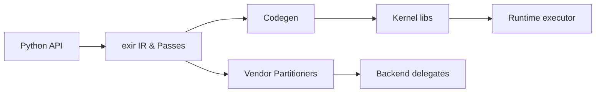

# pytorch/executorch

> PyTorch solution for deploying models for inference on mobile, embedded devices and microcontrollers.

## The problem
Porting a PyTorch model to constrained devices, with the right accelerators, without rewriting the toolchain.

## What it actually does
Exports a model to the PTE format via the `exir` library (capture, passes, partitioning), then runs it with a lightweight C++ runtime. Delegated backends: Apple CoreML and MPS, Arm Ethos-U, Qualcomm, Vulkan, XNNPACK, MediaTek, NXP, OpenVINO, Cadence. Android, iOS and Python bindings; portable, optimized and quantized kernels.

## How it is wired

## Trying it
The README provides no command; it points to the "Getting Started" page of the documentation.

## Cost and gotchas
License present but not identified by GitHub. About 1,300 open issues. Several build chains (CMake, SwiftPM, Buck2).

## What it is not
Not a training tool: on-device training is cited as experimental. Not an inference server.

## Alternatives
The README names no alternative.

## For you
Worth watching: good to know if your models must run on mobile or embedded; otherwise useless on the server side.
