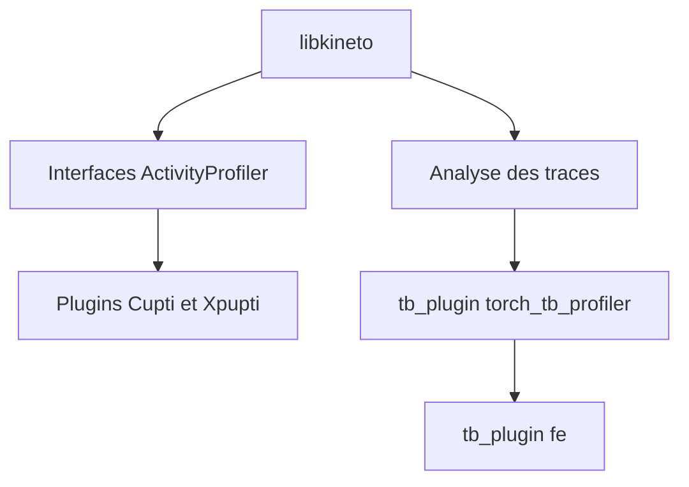

# pytorch/kineto

> Low-overhead GPU profiling library, engine of the PyTorch Profiler, for ML performance engineers.

## The problem
Finding out why a training run is slow requires tracing the GPU timeline without distorting it.

## What it actually does
- Libkineto traces GPU activity in-process, with Cupti, Roctracer and Xpupti plugins.
- Powers the PyTorch Profiler and aims at recommendations on common bottlenecks.
- Integrates system profiling tools and visualization platforms.
- Also contains the TensorBoard plugin (`tb_plugin`) with a React interface.

## How it is wired


## Trying it
```bash
# Aucune commande documentée : voir le README du dossier libkineto
# et la documentation de l'API du nouveau PyTorch Profiler.
```

## Cost and gotchas
A GPU is required to profile. Development frozen since September 24, 2026: Kineto is integrated into PyTorch, contributions happen elsewhere.

## What it is not
Not a tool to install separately: it is used through PyTorch. This repository is archived.

## Alternatives
No alternative named in the README.

## For you
Keep an eye on it: you already use it via `torch.profiler`; follow the PyTorch repository, not this one.
