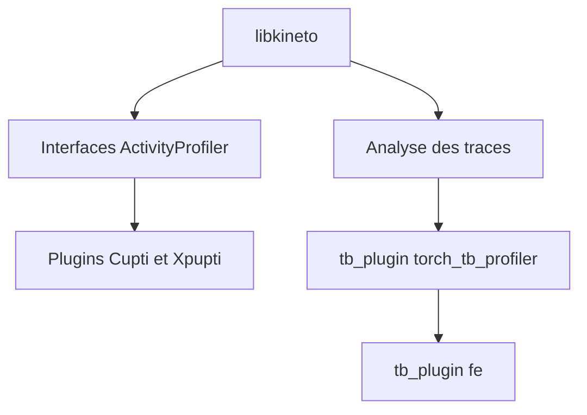

# pytorch/kineto

> Bibliothèque de profilage GPU à faible surcharge, moteur du PyTorch Profiler, pour ingénieurs performance ML.

## Le problème
Trouver pourquoi un entraînement est lent exige de tracer la chronologie GPU sans la fausser.

## Ce que ça fait vraiment
- Libkineto trace les activités GPU dans le processus, avec plugins Cupti, Roctracer et Xpupti.
- Alimente le PyTorch Profiler et vise des recommandations sur les goulots courants.
- Intègre des outils de profilage système et des plateformes de visualisation.
- Contient aussi le plugin TensorBoard (`tb_plugin`) avec interface React.

## Comment c'est branché


## Essayer
```bash
# Aucune commande documentée : voir le README du dossier libkineto
# et la documentation de l'API du nouveau PyTorch Profiler.
```

## Coût et pièges
Un GPU est nécessaire pour profiler. Développement gelé depuis le 24 septembre 2026 : Kineto est intégré à PyTorch, les contributions se font ailleurs.

## Ce que ce n'est pas
Pas un outil à installer à part : on l'emploie via PyTorch. Ce dépôt est archivé.

## Alternatives
Aucune alternative nommée dans le README.

## Pour toi
À surveiller : tu l'utilises déjà via `torch.profiler` ; suis le dépôt PyTorch, pas celui-ci.

