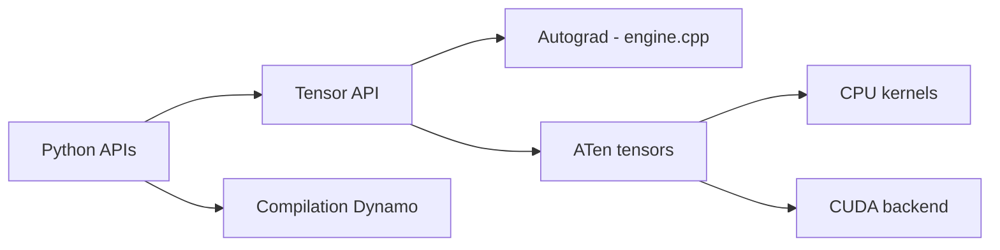

# pytorch/pytorch

> Python framework for tensor and neural network calculations with autograd, for machine learning researchers and engineers.

## The problem
Write and train neural networks on GPUs without reimplementing tensors, gradient calculation, or CUDA kernels.

## What it actually does
Provides NumPy-like CPU/GPU tensors, a reverse-mode autodiff that records operations and then calculates gradients, `torch.nn` for layers, `torch.jit` (TorchScript), multiprocessing that shares tensor memory, and data utilities. The code graph includes compilation (Dynamo, Inductor), distributed checkpointing (including Hugging Face formats), and an Android mobile runtime.

## How it is wired


## Trying it
```bash
# Binaires : commandes sur https://pytorch.org/get-started/locally/
docker run --gpus all --rm -ti --ipc=host pytorch/pytorch:latest
# Depuis les sources
git clone https://github.com/pytorch/pytorch
cd pytorch
pip install --group dev
python -m pip install --no-build-isolation -v -e .
```

## Cost and gotchas
Free. Compiled from sources: Python 3.10+, C++20 compiler, 10 GB of disk space, 30 to 60 minutes. When using Docker, `--ipc=host` or `--shm-size` is required for multi-processing.

## What it is not
Not a "one-stop" MLOps framework: it doesn't include experiment tracking or serving. Installation from source is cumbersome; binaries are usually sufficient. License not identified by GitHub: needs further review.

## Alternatives
- TensorFlow: Mentioned in the README as a static-graph approach, part of the Google ecosystem.
- Torch / Chainer: Sources of inspiration, historical.

## For you
To adopt: this is the foundation for almost all modern deep learning work; only the "unidentified" license warrants further review before redistribution.
