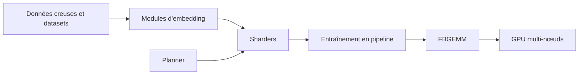

# pytorch/torchrec

> PyTorch library of parallelism primitives for training recommenders with large embedding tables.

## The problem
The embeddings of a recommendation system exceed the memory of a single GPU and must be distributed cleanly.

## What it actually does
Sharders (data-parallel, table-wise, row-wise, column-wise and combinations), a planner that generates a sharding plan, pipelined training that overlaps loading, transfers and compute, FBGEMM kernels, quantization, DLRM and DeepFM models. The README states that the library powers many production models at Meta.

## How it is wired


## Trying it
```bash
git clone --recursive https://github.com/meta-pytorch/torchrec
pip install -r requirements.txt
python setup.py install develop
torchx run -s local_cwd dist.ddp -j 1x2 --script test_installation.py -- --cpu_only
```

## Cost and gotchas
Assumes multi-GPU to benefit from sharding. Installation from source on PyTorch and FBGEMM nightly, to be aligned with the CUDA version (12.6, 12.8, 12.9).

## What it is not
Not a turnkey tool: it is a building block for engineers. The README recommends not building it yourself unless you need to.

## Alternatives
No alternative named in the README.

## For you
Keep an eye on it: a reference if you train large recommenders, of no interest without that need or a GPU cluster.
