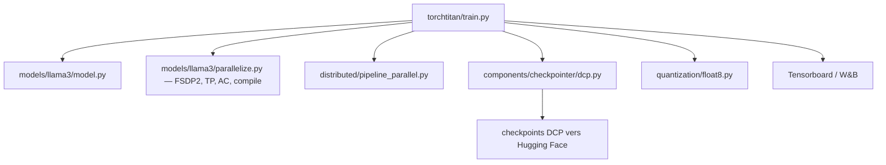

# pytorch/torchtitan

> PyTorch-native platform for experimenting with and training generative models at scale.

## The problem
Applying FSDP2, tensor parallel, pipeline parallel and context parallel to a model usually requires rewriting it.
Existing implementations mix model and parallelism so much that you no longer know what you are measuring.

## What it actually does
A minimal, clean-room implementation of PyTorch scaling techniques: composable multi-dimensional parallelisms with a minimum of changes to the model code.
Initialization on the meta device, per-operation selective activation checkpointing, distributed checkpoints (including asynchronous ones) interoperable with `torchtune`, `torch.compile` support.
Low-precision training in Float8 and MXFP8 on Blackwell, BF16 optimizer states, gradient accumulation derived from `--training.num_tokens_per_train_step`.
Loss, GPU memory, tokens/s, TFLOPs and MFU are logged to Tensorboard or Weights & Biases; performance is reported up to 512 GPUs.

## How it is wired


## Trying it
```bash
git clone https://github.com/pytorch/torchtitan
cd torchtitan
pip install -r requirements.txt
python scripts/download_hf_assets.py --repo_id meta-llama/Llama-3.1-8B --assets tokenizer --hf_token=...
MODULE=llama3 CONFIG=llama3_8b ./run_train.sh
```

## Cost and gotchas
You need GPUs — the starter example is a Llama 3 8B on eight GPUs — and the README recommends a PyTorch nightly, not a stable release.
`torchao` is deliberately excluded from the dependencies so as not to resolve `torch` wrongly: install it yourself, matching the CUDA variant, only for float8/MXFP8/NVFP4.

## What it is not
It is not a turnkey fine-tuning framework: `torchtune` is cited for that, and torchtitan produces checkpoints that load into it.
It is not stable either — "under extensive development", and access to the Llama weights goes through a request to Meta.

## Alternatives
- `torchtune`: cited for fine-tuning, downstream of the checkpoints produced here.
- vLLM: cited via `torchtitan/rl/generate.py` for inference on the trained models.

## For you
Worth following if you want to read a readable implementation of PyTorch parallelisms; the entry price is a cluster.
