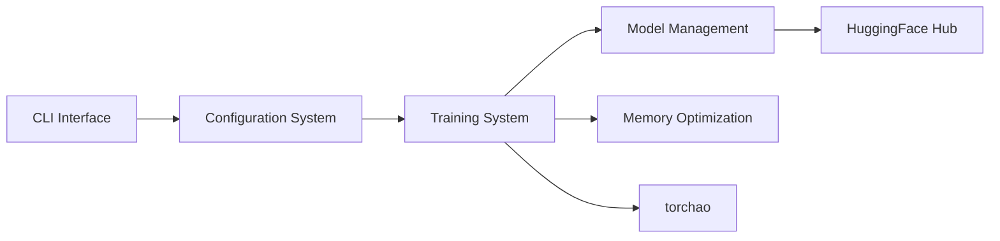

# pytorch/torchtune

> PyTorch library of LLM post-training recipes (SFT, DPO, PPO, GRPO), no longer maintained.

## The problem
Fine-tuning an LLM with LoRA, distillation or RLHF requires assembling models, data and memory optimizations.

## What it actually does
A `tune` CLI that launches YAML-configured recipes (full SFT or LoRA/QLoRA, distillation, DPO, PPO, GRPO, QAT) on one or several GPUs. PyTorch implementations of Llama, Gemma, Mistral, Phi and Qwen. The README quantifies memory savings (QLoRA at 4.6 GiB on Llama 3.2 3B in its table) and details the supported combinations.

## How it is wired


## Trying it
```bash
pip install torch torchvision torchao
pip install torchtune
tune download meta-llama/Meta-Llama-3.1-8B-Instruct --output-dir /tmp/Meta-Llama-3.1-8B-Instruct --ignore-patterns "original/consolidated.00.pth" --hf-token <HF_TOKEN>
tune run lora_finetune_single_device --config llama3_1/8B_lora_single_device
```

## Cost and gotchas
GPU required; Hugging Face token for Llama weights. The README states development stopped in 2025: no new models or guaranteed fixes. The catalog does not give the license (the README cites BSD-3-Clause in the BibTeX reference).

## What it is not
Not a living library: the warning at the top announces the end of maintenance. The listed models (Llama 4, Qwen3) will remain frozen.

## Alternatives
No alternative named in the README; it points to a post on the future of torchtune.

## For you
Ignore for a new project: the tool is no longer maintained, so an active fine-tuning tool is better; useful only as a code reference.
