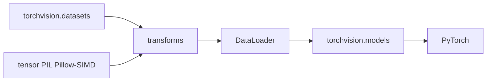

# pytorch/vision

> Common datasets, model architectures and image transformations for PyTorch.

## The problem
Every vision project redoes the same building blocks: dataset download, preprocessing, backbone.
Rewriting these layers by hand introduces silent discrepancies with published results.

## What it actually does
Provides the usual public datasets, downloading and preparing them, without hosting them.
Ships vision architectures and the standard image transformations.
Supports three image backends: torch tensors, Pillow, or Pillow-SIMD as a drop-in replacement for Pillow.
A compatibility table links each `torchvision` version to a `torch` version and a Python range.

## How it is wired

## Trying it
No installation command in the README: it points to the official instructions on pytorch.org
to install compatible versions of `torch` and `torchvision`, and to `CONTRIBUTING.md` for building.

## Cost and gotchas
Version compatibility is strict: `torch 2.13` goes with `torchvision 0.28`, Python 3.10 to 3.14.
Picking the wrong pair is the leading cause of import crashes.

## What it is not
Not a data host: the project does not distribute the datasets and guarantees neither their quality nor your usage license.
Not a training framework: it provides the building blocks, not the loop.
Not independent of PyTorch, obviously: it is an extension, not a standalone library.

## Alternatives
`Pillow-SIMD` — drop-in replacement for Pillow, faster, cited as a possible backend.

## For you
Essential as soon as you touch images in PyTorch; check the version table before any `pip install`.
