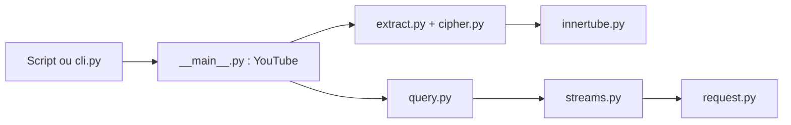

# pytube/pytube

> Dependency-free Python library, and CLI, for downloading YouTube videos.

## The problem
Fetching a YouTube video or playlist from a script without going through an external tool.

## What it actually does
Creates a `YouTube` object, lists its streams (progressive or DASH), filters them by resolution or extension, and downloads the chosen one. It also handles captions (SRT export), playlists, channels, search, and progress callbacks.

## How it is wired


## Trying it
```bash
python -m pip install pytube
pytube https://youtube.com/watch?v=2lAe1cqCOXo
```

## Cost and gotchas
Free. Depends on YouTube's internals: 769 open issues, last push in August 2024. The README admits that the PyPI version may lag behind.

## What it is not
Not guaranteed to be stable: any change on YouTube's side can break extraction. It circumvents nothing, it follows the site.

## Alternatives
- No alternative named in the README.

## For you
Ignore: little activity and fragile against YouTube; to feed an audio/video corpus, first check a maintained tool.
